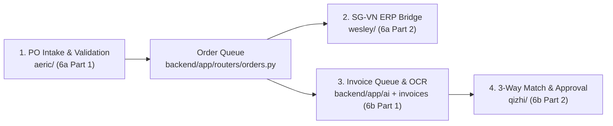

# Koda AI Operations Workspace — System Architecture (v1.0)

Unified FastAPI + vanilla SPA application integrating **Problem Statements 6a & 6b** (plus supporting Operations Planning & Project Tracking) behind one shared persistence layer and B2B operational UI.

---

## 1. End-to-End Architecture & Team Ownership



| Stage | Owner | Package / Module | Core Capability |
| --- | --- | --- | --- |
| **6a Part 1 — PO Intake** | Aeric | `aeric/` (`router.py`, `service.py`, `po_parser.py`, `po_intake.js`) | Rules-first PDF/CSV/email/camera-scan PO parser + OCR/OpenAI fallback, Levenshtein fuzzy SKU matching, clarification email draft |
| **6a Part 2 — SG–VN ERP Bridge** | Wesley | `wesley/` (`router.py`, `service.py`, `exporter.py`, `erp_bridge.js`) | SG HQ vs Vietnam Factory price masking, unmapped SKU transfer-price resolution, lead-time risk advisor, Dual Navision 2013 CSV/PDF export |
| **6b Part 1 — Invoice OCR & Gen** | Lucas | `backend/app/ai/`, `invoices.py`, `invoice_generator.py`, `scanner.js` | PDF text/regex + OpenAI scan extraction, camera crop/enhance scanner, Review Queue, multi-invoice & thermal receipt test generators |
| **6b Part 2 — 3-Way Match** | Qizhi | `qizhi/` (`router.py`, `service.py`, `matching.py`, `receipt_parser.py`, `suggester.py`, `store.py`, `three_way_match.js`) | Invoice vs PO vs hard-copy POS receipt matcher, diff matrix, rule + optional Claude task suggester, dept-head segregation-of-duties approval, SHA-256 hash-chained audit trail |

---

## 2. Database & Persistence ERD (`backend/app/models.py`)

`app/database.py` persists the working collections in `app/store.py` to SQLite (`backend/koda.db`) by default or Supabase Postgres (`workspace` schema) when `DATABASE_URL` is configured. Uploaded invoice files optionally sync to Supabase Storage (`app/services/supabase_store.py`), and `documents.csv` mirrors orders + invoices via `app/services/documents.py`. Qizhi's `qizhi/store.py` maintains a self-contained in-memory task store and SHA-256 hash-chained audit log.

```mermaid
erDiagram
    PURCHASE_ORDERS {
        int pk PK
        string po_number UK
        string supplier
        string currency
        bool auto_created
        json lines
    }
    SUPPLIER_INVOICES {
        int pk PK
        string invoice_number
        string po_number FK
        string supplier
        string invoice_date
        string currency
        float tax_rate
        float tax_amount
        json lines
        string file_path
    }
    CATALOG_ITEMS {
        int pk PK
        string sku UK
        string name
        float unit_price
    }
    ORDERS {
        int pk PK
        string id UK
        string order_number
        string transaction_id
        string type
        string counterparty
        string order_date
        string delivery_date
        string currency
        float total
        string status
        json lines
        json extra
    }
    PROJECTS {
        int pk PK
        string id UK
        string name
        string site
        string owner
        string due_date
    }
    TASKS {
        int pk PK
        string id UK
        string project_id FK
        string title
        string owner
        string status
    }
    PURCHASE_ORDERS ||--o{ SUPPLIER_INVOICES : "matched against"
    PROJECTS ||--o{ TASKS : "tracks"
```

---

## 3. REST API Summary (`backend/app/main.py`)

| Prefix / Router | Key Endpoints | Purpose |
| --- | --- | --- |
| **Core** | `GET /api/health`, `GET /api/documents`, `GET /api/documents.csv` | Health check (`database` backend) and unified document CSV export |
| **6a Pt 1 (`aeric`)** | `POST /api/po-intake`, `/validate`, `/email`, `/submit`, `GET /samples` | Hybrid PO extraction, live inline validation, buyer email draft, queue submission |
| **6a Pt 2 (`wesley`)** | `GET /api/erp-bridge/orders`, `PUT /transfer-prices/{sku}`, `POST /orders/{id}/convert`, `/advisor`, `GET /export.csv`, `/export.pdf`, `POST /seed/{scenario}` | SG–VN role price masking, BOM mapping, rush advisor, Dual Navision CSV/PDF |
| **Orders & Queue** | `GET/POST /api/orders`, `POST /orders/{id}/approve`, `/reject`, `PATCH /orders/{id}`, `GET /orders/export.csv`, `GET/PUT/POST /api/invoice-queue/*` | Order Queue lifecycle and approved-order invoice generation |
| **6b Pt 1 (`invoices`)** | `GET /api/invoices`, `POST /api/invoices/upload`, `GET /api/purchase-orders`, `GET /purchase-orders/{po}/invoice.pdf`, `POST /api/invoice-generator/pdf` | Invoice extraction/matching, PO PDF variant generator, standalone invoice PDF builder |
| **6b Pt 2 (`qizhi`)** | `GET /api/three-way-match/users`, `/scenarios`, `/invoices`, `POST /receipts/extract`, `POST /match`, `GET/PATCH /tasks/*`, `POST /tasks/{id}/request-approval`, `/decision`, `GET /audit`, `/audit/verify` | POS receipt OCR/parse, 3-way diff matrix, task workflow, dept-head approval, audit chain verification |
| **Projects & Planning** | `GET/POST /api/projects/*`, `PATCH/DELETE /api/tasks/*`, `GET /api/planning` | EM Services tracker and 6c MRP shortage sequencing |

---

## 4. Technical Trade-Offs & Security Controls
- **Rules-first + OCR + LLM fallback:** CSVs, text-layer PDFs, and clean scans run locally (`0` AI tokens, ~1 ms); LLM Vision (`OPENAI_API_KEY`) or task phrasing (`ANTHROPIC_API_KEY`) only run when needed, cutting token costs below manual labor and File.ai minimums.
- **Security & validation:** 10 MB upload caps, magic-byte file verification (`%PDF`, PNG/JPG), Pydantic field bounds (`ge=0`, max lengths), `esc()` HTML escaping across all frontend modules, segregation of duties in approvals, and environment-variable-only secrets.
- **Deployment:** Static frontend hosted on Vercel (`vercel.json` copies `aeric/po_intake.js`, `wesley/erp_bridge.js`, and `qizhi/three_way_match.js` into `frontend/`), paired with the FastAPI backend.
